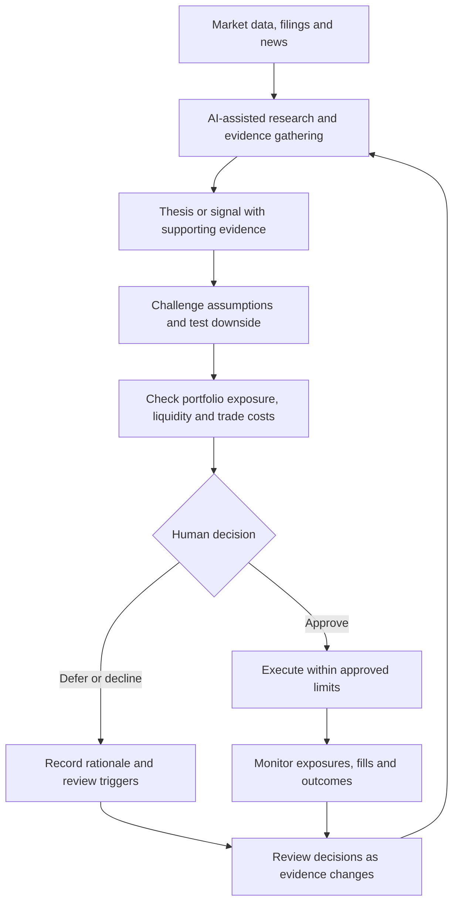

# RM Investment Co

**Building for a world where every investment thesis is continuously tested.**

Markets move faster than any team can read. AI could change what a small investment team is capable of by giving it the reach to follow more companies, the capacity to test more ideas, and the memory to learn from every decision.

We’re building toward an investment and trading platform that connects research, risk and execution in one feedback loop. A thesis should carry its evidence, its strongest counterargument and the conditions that would invalidate it. When those conditions change, the team should be able to see what changed, which positions are exposed and whether the original decision still holds.

## What becomes possible

- **Investing becomes continuous.** A new filing, earnings call or market move can prompt a review of the specific assumptions it affects. Over time, a team can maintain more live theses and revisit them as evidence changes.
- **Trading becomes a testable process.** A signal can be replayed against historical data, stressed across market regimes and evaluated after costs. Live fills and slippage can then show where the strategy behaves differently from the test.
- **Portfolio risk becomes part of every decision.** Before a trade, the team can see what it adds to existing exposures, where liquidity could constrain an exit and how losses might compound under stress.
- **Decisions become a research asset.** With a record of what the team knew and expected at the time, it can distinguish a sound decision with a bad outcome from a flawed process that happened to work.

## How the loop works

The diagram shows the target workflow. People own investment decisions and approve trades. AI helps gather evidence, challenge assumptions and monitor what changes.

## Where we are today

The project is in development and review. The current focus is the research and oversight foundation, including specialist analysis, traceable evidence, dependable reporting and explicit controls. The workflow above describes the direction of the build. Implementation details stay private.

Questions about the vision or architecture are welcome through [GitHub Issues](https://github.com/rohaanmehta3-cell/rm-vision/issues).

*This project overview makes no performance claims and does not constitute an investment offering.*
