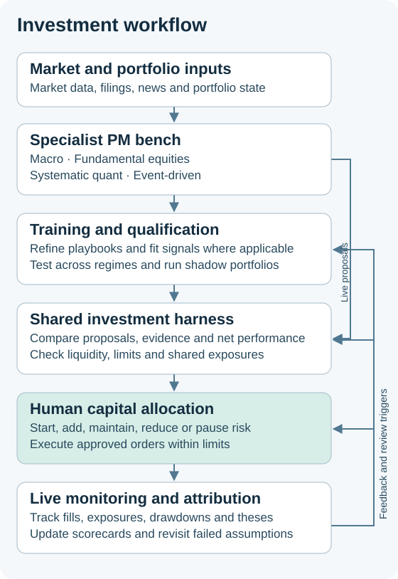

# RM Investment Co

**Building an AI-native investment platform where a small team can run a bench of specialist PMs, continuously test their ideas, and allocate risk as the evidence changes.**

This public repository presents the vision, target architecture and a synthetic example of the investment harness. The implementation and deployment environment are private. The example uses invented inputs and outcomes.

Markets move faster than any team can read. AI could change what a small investment team is capable of by giving it the reach to follow more companies, the capacity to test more ideas, and the memory to learn from every decision.

We’re building toward an investment and trading platform that connects research, risk and execution in one feedback loop. A thesis should carry its evidence, its strongest counterargument and the conditions that would invalidate it. When those conditions change, the team should be able to see what changed, which positions are exposed and whether the original decision still holds.

## What becomes possible

- **Investing becomes continuous.** A new filing, earnings call or market move can prompt a review of the specific assumptions it affects. Over time, a team can maintain more live theses and revisit them as evidence changes.
- **Trading becomes a testable process.** A signal can be replayed against historical data, stressed across market regimes and evaluated after costs. Live fills and slippage can then show where the strategy behaves differently from the test.
- **Portfolio risk becomes part of every decision.** Before a trade, the team can see what it adds to existing exposures, where liquidity could constrain an exit and how losses might compound under stress.
- **Decisions become a research asset.** With a record of what the team knew and expected at the time, it can distinguish a sound decision with a bad outcome from a flawed process that happened to work.

## Where the edge comes from

We believe the durable edge is in the **harness around the models**. Models will improve and become easier to swap. The harness determines what evidence they see, what tests an idea must pass, who can commit capital and what the system learns after a decision.

That means giving each proposal the same basic record: the evidence available at the time, the strongest counterargument, the conditions that would invalidate it and the risks it adds to the book. The harness would check for stale data, enforce portfolio limits and route exceptions to a human. It would also keep a record of rejected ideas alongside approved trades, so we can study what our filters caught and what they missed.

## A bench of portfolio managers

We’re exploring four complementary mandates. Each would have a defined universe, time horizon, benchmark and risk budget.

| PM mandate | What it looks for | How it earns risk budget |
| --- | --- | --- |
| **Macro** | Changes in growth, inflation, policy and liquidity that could reprice rates, currencies or equity indices. | States what the market appears to price in, maps upside and downside scenarios, and identifies what would invalidate the view. |
| **Fundamental equities** | Gaps between a company’s operating trajectory and the expectations implied by its price. | Connects filings and earnings evidence to a valuation range, a catalyst and a clear downside case. |
| **Systematic quant** | Repeatable signals across a defined universe, with explicit rules for entry, sizing and exit. | Shows out-of-sample results, sensitivity to parameters and regimes, and viability after turnover, transaction costs and capacity constraints. |
| **Event-driven** | Time-bound opportunities around earnings, corporate actions and other identifiable catalysts. | Specifies the event window, scenario payoffs, liquidity and gap risk, and what would justify exiting early. |

A single inflation surprise might produce a macro proposal to reduce duration, a systematic signal to cut equity risk and a fundamental proposal to buy a company into weakness. The harness would map those proposals to the existing book, surface shared exposures and compare the risk each one adds. People would decide which ideas receive capital and approve trades.

We would evaluate each mandate against its own benchmark and constraints, then judge what it contributes to the combined book after costs. Capital would follow the evidence through a staged path from historical testing to shadow portfolios and, where approved, a limited live risk budget. The record would capture where assumptions broke, where execution diverged from simulation and whether the mandate added a distinct source of return or duplicated existing exposure.

## How the loop works

The diagram shows the target workflow. Training includes refining research playbooks and, where applicable, fitting quantitative signals. Held-out tests and shadow portfolios inform initial risk budgets. Live results and risk triggers feed ongoing allocation reviews. People own allocation decisions and approve trades.

We’re considering a shared **econometrics research agent** that scans incoming data in the lake for candidate signals. It would log each hypothesis, the data available at the time, the expected holding period and the proposed test. PMs would review candidates before qualification, which would check for look-ahead bias, account for repeated testing, and measure whether the signal holds up out of sample and after estimated costs. Candidates that pass could progress to a shadow portfolio. People would still approve any live risk.

## Worked example

All issuer details, observations and figures below are synthetic. The example illustrates the records and decisions the harness is designed to support.

### Thesis record · Fundamental equities

| Field | Illustrative record |
| --- | --- |
| Proposal | Open a 1.0% long position in fictional issuer Northline Components over a six-month horizon. |
| Evidence and catalyst | In the sample filing, service mix rose from 24% to 30% and gross margin rose 180 basis points year over year. The next two earnings releases test whether the improvement persists. |
| Strongest counterargument | Low-margin hardware sales fell sharply, mechanically raising the service mix. The margin gain could reverse as hardware volumes recover. |
| Invalidation | Close the position if service gross margin falls below 40% or the next filing shows that service revenue declined year over year. |
| Portfolio risk added | The position raises related industrial exposure from 7% to 8% against a 10% limit. In a scenario where the stock falls 25%, the position adds a 25 basis point loss to the portfolio before spillovers. |
| Human decision | Defer the 1.0% proposal. Approve a 0.5% starter subject to a liquidity check, and review any increase after the next filing. |

### Mandate scorecard · 90-day shadow review

| Metric | Synthetic result |
| --- | ---: |
| Gross mandate return | +2.40% |
| Estimated commissions and slippage | 0.35 percentage points |
| Net mandate return | +2.05% |
| Mandate benchmark return | +1.60% |
| Net excess return | +0.45 percentage points |
| Maximum drawdown on the net shadow equity curve | −3.80% |

**Allocation decision.** Maintain the shadow allocation and defer live capital. The mandate beat its benchmark after estimated costs in this example, but attribution showed that most of the gains came from a sector exposure already present in the book. The next review would test whether the mandate adds value after accounting for that exposure.

## Deployment status

The implementation is private and preparing for deployment. The workflow above describes the target operating model. A private walkthrough can cover the current build and its deployment readiness.

Questions about the vision or architecture are welcome through [GitHub Issues](https://github.com/rohaanmehta3-cell/rm-vision/issues).

*This project overview makes no performance claims and does not constitute an investment offering.*
